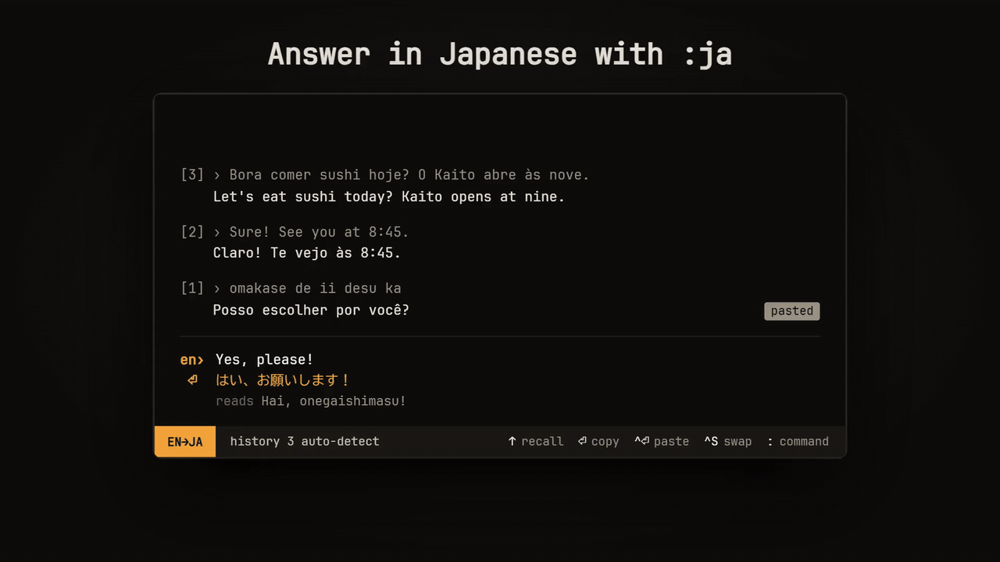

# tradu

A popup translator for people who live on the keyboard. Press a hotkey from anywhere, type, press Enter, and the translation is on your clipboard and the popup is gone. You never need the mouse.

If text is selected when you press the hotkey, it's already in the popup and being translated.



## Install

Paste this into PowerShell. It installs tradu for your user (no admin rights, no clicks) and starts it:

```powershell
irm https://raw.githubusercontent.com/kayfgit/tradu/main/install.ps1 | iex
```

Then press **Ctrl+Shift+Space** anywhere. Run the same command again to update.

You can also download [tradu-setup.exe](https://github.com/kayfgit/tradu/releases/latest/download/tradu-setup.exe), or [tradu-portable.exe](https://github.com/kayfgit/tradu/releases/latest/download/tradu-portable.exe) to run it without installing. tradu needs Windows 10 or 11.

To uninstall, use **Settings › Apps**, or run `& "$env:LOCALAPPDATA\tradu\uninstall.exe"`.

## Features

- **Instant:** it stays resident in the tray, and the popup takes focus about 30 ms after the hotkey.
- **Live:** it translates as you type, and Enter always copies the result for exactly what's on screen.
- **Learner-friendly:** it shows romanization (`家` → *Ie*), dictionary alternatives for single words, and pronunciation.
- **Light:** a 4 MB binary using about 80 MB of memory in total (the Rust process plus a trimmed WebView2).
- Covers 137 languages, with fuzzy search by English name, native name or code.

## Keys

The global hotkey is **Ctrl+Shift+Space**. You can change it in the config.

- **Nothing selected:** the popup opens with your last languages, ready to type.
- **Text selected** in any app: the popup opens with that text in it and translates it straight away. Press Enter to copy the translation, or Ctrl+Enter to paste it over the selection (in an editable field).

### Typing

| Key | Action |
| --- | --- |
| *type* | Translate live |
| **Enter** | Copy translation and close |
| **Ctrl+Enter** | Close and **paste the translation into the app you came from** |
| **Shift+Enter** | New line |
| **Alt+1…9** | Copy dictionary alternative *n* and close |
| **Ctrl+S** | Swap languages (the translation becomes the input) |
| **Ctrl+L** | Pick source language, then target language |
| **Ctrl+F** / **Ctrl+T** | Pick only the source (*from*) or only the target (*to*) |
| **Ctrl+P** / **Ctrl+Shift+P** | Listen to the translation / the input |
| **Ctrl+Shift+C** | Copy translation, stay open |
| **Tab** | Move into the translation to select part of it |
| **Esc** | Close |

When the popup opens, your previous text is still there but selected, so typing replaces it.

### In the translation (after Tab)

Select with **Shift+arrows**, then press **Enter** to copy the selection or **Ctrl+Enter** to paste it back. **Tab** or **Esc** returns to the input.

### Language picker

| Key | Action |
| --- | --- |
| *type* | Fuzzy-match a name, native name or code (`ja`, `jap`, `日本`, `deu`…) |
| **1…9** | With an empty query: pick from the list of recent and popular languages |
| **↑ ↓** / **Ctrl+N Ctrl+P** / **Ctrl+J Ctrl+K** | Move |
| **Enter** / **Tab** | Pick and continue |
| **Esc** | Keep the current language and continue |
| **Shift+Tab** | Go back from target to source |

### Smart defaults

- **Bidirectional pairs.** With the source on *Detect language*, typing in the target language flips the target to your previous language, falling back to your system language. If you set the target to Japanese, typing English gives Japanese and typing Japanese gives English. You rarely need to change languages.
- Picking the language that's already on the other side swaps the two languages.

### How the selection is read

The hotkey asks the app to copy its selection with **Ctrl+Insert**, the standard Windows copy shortcut, then reads the clipboard. It doesn't use Ctrl+C, because in a terminal Ctrl+C interrupts the running program when nothing is selected.

Your clipboard is put back afterwards if it held text. If it held an image or files, the selection stays on the clipboard instead.

- The popup waits at most 40 ms for the app before opening. A slower app's selection still fills in, as long as you haven't started typing.
- **VS Code** copies the whole current line when nothing is selected, so the hotkey grabs that line. Set `"editor.emptySelectionClipboard": false` to stop it.
- Apps that don't support Ctrl+Insert (rare: some games and custom-drawn UIs) just open the popup normally.

## Config

Open it from the tray with **Edit config**, then use **Reload config** to apply your changes. The file is at `%APPDATA%\com.tradu.translator\config.json`.

```json
{
  "hotkey": "Ctrl+Shift+Space",
  "start_in": "input",
  "hide_on_blur": true,
  "debounce_ms": 200
}
```

- `start_in`: `"input"` (default) opens straight into the text box with your last languages. `"source"` opens in the source picker, then the target picker, then the input.
- `hotkey`: modifiers `Ctrl`, `Shift`, `Alt` and `Super`, plus a key such as `Space`, `T`, `F9` or `Backquote`.

The tray menu also has **Start at login**.

## Build

You need Rust (MSVC toolchain on Windows) and WebView2, which ships with Windows 11. You don't need Node.

```bash
cd src-tauri
cargo build --release        # → target/release/tradu.exe
cargo test -- --include-ignored   # includes one live network test
```

For the installer, run `cargo install tauri-cli --version "^2" --locked` once, then `cargo tauri build`. The installer is written to `target/release/bundle/nsis/`. It installs for the current user only, so it doesn't need admin rights.

### Releasing

Bump `version` in `src-tauri/tauri.conf.json`, commit, then push a matching tag:

```bash
git tag v0.2.0
```

```bash
git push origin v0.2.0
```

The [release workflow](.github/workflows/release.yml) builds on GitHub and publishes `tradu-setup.exe` and `tradu-portable.exe` to a new release. The install command always fetches the latest release.

To iterate on the UI without rebuilding, serve `src/` (for example `python -m http.server -d src`) and open it in a browser. The page detects that it isn't inside Tauri and calls Google directly.

## How it's built

- **Tauri 2 / Rust backend** (`src-tauri/src`): global hotkey, tray, single instance, clipboard, and translation requests. `origin.rs` handles the app you came from: reading its selection and pasting back into it. The HTTP connection is warmed up when the popup opens, so the first translation doesn't pay for a TLS handshake.
- **Frontend** (`src/`): plain HTML, CSS and JS with no framework or bundler. All the keyboard logic is in `main.js`.
- WebView2 runs with software rendering, and the network service runs inside the main process. For a small text UI this halves memory, from about 160 MB to about 80 MB.

**Why not a GPU-native toolkit (egui, iced)?** A translator has to render *every* script correctly: Arabic and Hebrew right-to-left, Devanagari and Thai shaping, CJK glyph variants. It also needs working IME input for Japanese, Chinese and Korean. The system web engine gets all of that right for free, and the lighter toolkits still don't.

Translations come from Google Translate's keyless public endpoint. It's free and fast, but unofficial, so heavy use can get you rate-limited.

## License

[MIT](LICENSE)
